# 视觉风格：像素可以不「复古」

> 编写日期：2026-09-30
> 回答的问题：像素画的游戏感有了，但年代感太重；近几年的像素风格是什么样的？
> 结论先行：把「像素」和「复古」拆开。近几年好看的像素游戏，像素只是笔触，新鲜感来自色板、分辨率、描边、光影、后期和 UI 这六个杠杆。

---

## 目录

1. [为什么现在的看起来年代感重](#1-为什么现在的看起来年代感重)
2. [近几年像素风的谱系](#2-近几年像素风的谱系)
3. [推荐方向：hi-bit 治愈系 + HD-2D 微缩](#3-推荐方向hi-bit-治愈系--hd-2d-微缩)
4. [具体规范（替换产品构想第 6 节）](#4-具体规范替换产品构想第-6-节)
5. [原型里的「现代 / 经典」开关](#5-原型里的现代--经典开关)
6. [素材与工具](#6-素材与工具)
7. [第三条路：风格化 3D CG（《潜水员戴夫》新画风）](#7-第三条路风格化-3d-cg潜水员戴夫新画风)
8. [定案（2026-09-30）：世界风 CG](#8-定案2026-09-30世界风-cg)
9. [真 3D 渲染验证（Blender / Cycles）](#9-真-3d-渲染验证blender--cycles)
10. [平面插画 + 3D 渲染（第四轮）](#10-平面插画--3d-渲染第四轮)
11. [小人 v3：一体圆润（第四轮）](#11-小人-v3一体圆润第四轮)
12. [第五轮：精致化、手机排版、昼夜与宇宙](#12-第五轮精致化手机排版昼夜与宇宙)
13. [第六轮：首页的阶段卡片、悬浮的新建按钮、折叠屏](#13-第六轮首页的阶段卡片悬浮的新建按钮折叠屏)
14. [第七轮：按钮精简、不用蓝色填充、和系统 App 一样的字](#14-第七轮按钮精简不用蓝色填充和系统-app-一样的字)
15. [第八轮：去色、弹层精简](#15-第八轮去色弹层精简)
   - [9.1 关键视觉 v1 → v2：再分析、再改](#91-关键视觉-v1--v2再分析再改)

---

## 1. 为什么现在的看起来年代感重

现在的原型和示意图带着六个「8 / 16 位机」时代的信号，每一个都在说「这是老游戏」：

| 信号 | 现在的做法 | 观感 |
|---|---|---|
| 色板 | 纯度高的红、蓝、绿，纯黑描边 | FC / SFC 卡带的味道 |
| 分辨率 | 小人 16 × 20，建筑一格一块砖 | 「点数」少，细节靠脑补 |
| 描边 | UI 芯片 2 px 黑边 + 硬投影，标牌黑框 | 像素 RPG 的对话框 |
| 光影 | 三面固定明暗，没有环境光、没有影子渐变 | 平 |
| 后期 | 没有景深、没有暗角、没有粒子 | 画面「干」 |
| 字体 | 点阵字体（DotGothic / Unifont） | 直接把年代写在脸上 |

像素本身不是问题：《星之海》《风来之国》也是像素，没人觉得它们旧。

---

## 2. 近几年像素风的谱系

| 流派 | 代表作（年份） | 「新」在哪 | 对地球Online 的价值 |
|---|---|---|---|
| **HD-2D** | 歧路旅人 II（2023）、勇者斗恶龙 III HD-2D（2024）、三角战略（2022） | 像素精灵放进 3D 场景，移轴景深、动态光、体积光、粒子；相机固定斜角 | **直接对应我们的「微缩模型」**：3D 积木底板 + 像素小人 + 移轴，就是 HD-2D 的配方 |
| **hi-bit 画意像素** | 星之海（2023）、风来之国（2021，上海皮克皮）、渎神 2（2023）、CrossCode（2018） | 32–64 px 以上的高分辨率精灵，手绘般的细节，动态光照与日夜，无纯黑描边 | 建筑、地标模板的精度目标；日夜色调 |
| **治愈系 / 粉彩像素** | Unpacking（2021）、Fields of Mistria（2024）、Coffee Talk（2020） | 低饱和暖色板、柔和描边或无描边、大量留白、慢节奏动效 | **色板与气质的目标**：旅行日记要的是这种「舒服」 |
| **像素 + 现代 UI** | 星之海、风来之国、Fields of Mistria 的菜单 | 世界是像素，UI 是干净的矢量卡片、现代字体、半透明与柔和阴影 | **UI 层直接照做**：悬浮纸片不做像素化 |
| **像素 + 3D 光影（2.5D）** | REPLACED（2026）、Cloudpunk（2020） | 像素纹理 + 实时光影 + 反射，画面密度高 | 夜景、雨天的方向；P2 以后 |
| **效果驱动** | Animal Well（2024）、Balatro（2024） | 靠光照、CRT / 色差等后处理让低分辨率像素显得当代 | 后期管线的参考，不照搬 CRT |
| **清爽等距** | Into the Breach（2018）、Songs of Conquest（2024） | 极简、可读性优先、信息层清楚 | 攻略信息层的参考 |
| **低模像素化 3D** | A Short Hike（2019） | 低分辨率渲染 3D，柔和色板，不描边 | 我们「低分辨率渲染目标」那一步的参考 |

规律：**越新的作品，像素越只负责「笔触」；色板、光影、后期、UI 负责「时代感」。**

---

## 3. 推荐方向：hi-bit 治愈系 + HD-2D 微缩

一句话：**世界按 HD-2D 的方式渲染（3D 积木 + 像素小人 + 移轴景深 + 动态光），色板走治愈系粉彩，UI 走现代矢量卡片，字体用系统字体。**

为什么是这个组合：

- 我们已经定了 3D 积木微缩世界（D10、D11），HD-2D 正是「像素精灵 + 3D 场景 + 固定斜角」，方向天然一致，不用推翻。
- 旅行攻略与日记要的是「舒服、想出发」，治愈系粉彩比高饱和复古更贴。
- UI 层是攻略信息层（D20），可读性优先，现代卡片比像素对话框读得快。
- 折叠机内屏 3000 nit、120 Hz，柔和渐变与半透明模糊在这块屏上是加分项；硬黑边反而显得糙。

不选的：纯 8-bit 复古、CRT 滤镜、1-bit 双色、全像素化 UI。

---

## 4. 具体规范（替换产品构想第 6 节）

| 项目 | v0.2 的约定 | 现代像素的约定 |
|---|---|---|
| 色板 | ≤ 32 色，主题叠 8–12 色 | 仍限色，但**降饱和、提亮暗部、暖色偏移**：无纯黑（最深 #2b2624 一类的暖黑）、无纯白；参考 Lospec 上的 Apollo、Resurrect 64、Endesga 32 这类现代调色板（用前核实许可） |
| 描边 | 世界无描边，UI 2 px 黑边 | 世界无描边或**同色系深一档的描边**；UI **无描边**，靠半透明与柔和阴影分层 |
| 角色 | 16 × 20 px | 先保留 16 × 20 的剪影，正式版升到 **32 × 40**（hi-bit），表情与服装细节靠分辨率而不是描边 |
| 积木纹理 | 16 × 16 | 16 × 16 保留，加**环境光遮蔽的暗角纹理**与顶面高光；屋顶、水面加 2–3 帧的微动 |
| 光影 | 三面固定明暗 | 一盏方向光 + 软阴影 + **日夜色调**（晨、日、黄昏、夜四档），夜里灯窗发光（bloom） |
| 后期 | 无 | **移轴景深**（画面上下 20% 轻微模糊）、**暗角**、轻微色彩分级（暖调）、**粒子**（红叶古都飘红叶、海岛飘海鸟、雪国飘雪） |
| 渲染分辨率 | 屏幕 1/2–1/3 | 保留（像素感来源），但小人与标牌层按屏幕分辨率画（HD-2D 的做法：像素精灵、清晰 UI） |
| UI 与字体 | 纸张 / 木框 9-slice，点阵字体 | **半透明白卡片 + 背景模糊 + 柔和阴影 + 12–14 px 圆角**，系统字体（鸿蒙 HarmonyOS Sans / iOS 苹方）；点阵字体只在「打卡」「成就」这类彩蛋处偶尔用 |
| 动效 | 8–12 fps 步进 | 小人步进保留（这是像素的灵魂），**镜头、面板、粒子、光照全部平滑**；对比感本身就是现代像素的标志 |
| 深色模式 | 夜晚色板 | 夜晚色调 + 灯光，UI 卡片改为半透明深色 |

---

## 5. 原型里的「现代 / 经典」开关

原型右下角加了「风格」按钮，默认现代，可切回经典对比。现代模式在不换素材的前提下做了这些：

| 做了 | 怎么做的 |
|---|---|
| 色彩分级 | 画底板时降饱和、降对比、微提亮，再叠一层暖色 soft-light |
| 暗角 | 径向渐变，边缘暖黑 |
| 移轴景深 | 画面上下两条带各画一遍模糊的世界，分级叠加 |
| 粒子 | 飘落的红叶（红叶古都主题） |
| 小人 | 脚下加椭圆软阴影 |
| 标牌 | 圆角卡片、柔和阴影、无黑框；序号改圆点 |
| UI | 所有纸片改为半透明白 + 背景模糊 + 柔和阴影，去黑边；系统字体 |
| 封面 | 渐变红 + 细描金边，去粗框 |

没做、要真素材才能做的：hi-bit 小人与地标、纹理级的环境光遮蔽、日夜光照、灯窗 bloom、屋顶水面微动。这些进 P1 的素材计划。

---

## 6. 素材与工具

- 画：Aseprite（像素）、Goxel / MagicaVoxel（积木）。
- 调色板：Lospec 上的现代调色板（Apollo、Resurrect 64、Endesga 32 等），用前核实各自许可。
- 后期：Cocos Creator 3.x 的后处理管线（bloom、景深、色彩分级都有现成节点）；移轴用「上下带模糊」即可，不必真正的景深。
- 参考库：Sea of Stars、Eastward、Octopath Traveler II、Unpacking、Fields of Mistria 的截图各存 10 张，按「色板 / 光 / UI」三栏贴在设计稿旁边。

---

## 7. 第三条路：风格化 3D CG（《潜水员戴夫》新画风）

> 追问：也可以试试《潜水员戴夫》变更之后的那种画风，下面这种 3D CG 风。

### 7.1 那是什么

《潜水员戴夫》原来是「像素角色 + 高精度手绘背景」的混合风，后来的宣传画风换成了**风格化 3D CG**：卡通比例（大头、圆手、粗壮的身体）、绘画质感的贴图、动画电影式的打光与景深，没有一个像素点。同一路的还有 Tiny Glade、Townscaper、LEGO Builder's Journey 这类「玩具微缩世界」，以及皮克斯式的角色。

### 7.2 同一块底板的三种画风

`示意图/画风对比_像素_vs_3DCG.png`（渲染脚本 `示意图/render_cg.py`）用京都东山一日出了三版：A 经典像素、B 现代像素、C 风格化 3D CG。原型右下「风格」按钮也能在三者之间切换（CG 模式的底板是平滑渲染的，小人换成圆润卡通）。

| | A 经典像素 | B 现代像素 | C 风格化 3D CG |
|---|---|---|---|
| 气质 | 复古、独立游戏 | 治愈、当代独立游戏 | 精致、动画电影、玩具模型 |
| 和「积木搭建」的契合 | 一般（像素砖不像积木） | 一般 | **最好**：积木本来就是 3D 玩具，LEGO Builder's Journey 就是证据 |
| 和折叠机大屏的契合 | 弱（像素放大只是更大） | 中 | **强**：3000 nit、120 Hz 的内屏配光影和景深是加分项 |
| 攻略信息层 | 像素 UI 读得慢 | 现代 UI | 现代 UI |
| 差异化 | 像素旅行 App 已有不少 | 尚可 | **旅行攻略里没人这么做** |
| 世界资产成本 | 低（tileset） | 中（hi-bit 素材） | **中**：底板与地标仍由积木模板程序化拼出，只是换成平滑渲染 + 光影；不用逐城建模 |
| 角色成本 | 低（16 × 20 精灵） | 中（32 × 40 精灵） | **高**：3D 建模 + 绑定 + 动画 + 模块化换装，一个角色顶几十张精灵 |
| 引擎与管线 | 任意 | 需要后处理 | 需要 3D 引擎的卡通 / 绘画着色、SSAO、景深、bloom；Cocos Creator 3.x 或团结引擎都够，方向与技术选型第 8 节一致（去掉像素化那一步） |
| 风险 | 年代感 | 「像素」标签本身可能限制受众 | 做不精致就成了廉价手游；角色是成败关键 |

### 7.3 建议

**世界走 C，角色先做小、做精，像素只留作彩蛋。** 理由：

1. 我们已经决定世界是 3D 积木（D10、D11），C 只是把「像素化后处理」拿掉、把光影和材质做足，方向不变、成本增量主要在角色。
2. 「地球Online」的野心是把地球做成一个可以走进去的世界，玩具模型的质感比像素更配这个名字，也更配旗舰折叠机。
3. 角色是唯一的高成本项：先做**一个**圆润卡通小人 + 模块化换装（发型 / 帽子 / 上衣 / 配件各几款），不做体型与脸型自定义；捏人槽位沿用 5.7 的设计。
4. 像素不必全丢：打卡贴纸、成就徽章、日记的章印可以用像素风，作为「游戏感」的彩蛋与品牌记忆点。

不确定的地方：C 的最终质感很吃美术功力，示意图只是「圆润 + 软阴影 + 暖调」的粗略近似，真正的判断要等一个用引擎做的 3D 小人 + 一块真实光照的底板出来（技术选型 spike 新增 S16：Cocos 里出一块 CG 底板 + 一个卡通小人，中端机 60 fps）。

---

## 8. 定案（2026-09-30）：世界风 CG

仓库主人拍板：**走世界风 CG，参照《潜水员戴夫》新画风。** 由此第 4 节「降饱和粉彩」的色板结论按产品构想 v0.3 第 6 节修正为「饱和而和谐的电影色 + 轮廓光」。 落地到文档：产品构想升 v0.3（第 1、5.2、5.7、6、7.3 节改写），技术选型第 8 节改为 CG 渲染管线并去掉像素化，角色改为 3D 卡通模型；像素只留作贴纸、徽章、章印的彩蛋。原型默认切到 CG 模式（现代像素、经典像素保留为对照）。P0 开工前的门槛是 S16：引擎里出一块真实光照的底板加一个卡通小人，并排《潜水员戴夫》评审。

---

## 9. 真 3D 渲染验证（Blender / Cycles）

> 追问：还是进一步参考《潜水员戴夫》的 CG 风格，差得有点多。

Pillow 与画布的矢量近似只能做到「圆润 + 软阴影」，出不了戴夫那种真实光照、次表面皮肤、景深与材质。于是在这个环境里装了 Blender 的 Python 模块（bpy 5.0），用 Cycles 离线渲染真 3D：

- 场景：`示意图/blender/render_blender.py`，直接读 `render_trip_book.py` 的地图与地标模板，搭成倒角积木、球形树、有波纹的水面、平缓的丘、展示台座；色调清朗海天。
- 光：太阳（软阴影）+ 天空光 + 暖色轮廓光（面光，右后方）；AgX 电影色调映射（Punchy）。
- 小人：基本体搭的卡通模型，大头、宽厚身体、鸭舌帽、刘海、眼白瞳孔、眉毛、张嘴、腮红、背包；皮肤带次表面散射，布料带织纹凹凸。
- 相机：特写 55 mm、f/2.0 景深；全景 38 mm、f/5.6。
- 后期：`示意图/blender/post.py` 做对比、饱和、高光偏暖、暗角、微颗粒。
- 产出：`示意图/blender/blender_hero.png`（小人特写）、`blender_plate.png`（底板全景）及 `_post` 版；CPU 渲染每张 1–2 分钟。

这一步的意义：**它是产品里引擎渲染的下限预览**（Cocos / 团结的实时管线能做到相近的光照与景深），也是 S16 的对照基准。仍然差的是：手绘质感的贴图、角色的布料褶皱与毛发、更讲究的造型比例，这些要美术进场。

### 9.1 关键视觉 v1 → v2：再分析、再改

> 追问：还是不如潜水员戴夫。再分析再改。

把 v1（元球拼的小人 + 俯拍底板）和《潜水员戴夫》的关键视觉并排，差距拆成五项，逐项对应改法：

| # | 差在哪 | 戴夫怎么做 | v2 怎么改（`示意图/blender/render_keyvisual.py` 重写） |
|---|---|---|---|
| 1 | **造型**：元球阈值把头和发帽缩到三分之二，五官悬空、身体被树挡；根子上是「基本体拼接」撑不起角色 | 角色是雕出来的整体，轮廓线从头到脚连续、无接缝 | 骨架线 + Skin 修改器 + 细分 → 一体网格的身体与四肢；两骨 IK 摆出「扶帽檐 + 迈步」的行走姿势；头相对身体回转 16° 看镜头 |
| 2 | **脸**：球体眼白 + 圆柱眉毛做不出「设计过的脸」 | 脸是画出来贴上去的（动物森友会、风之杖同路）：眼型、虹膜渐变、高光、睫毛都是画的 | Pillow 画 1024² 贴图（大眼、琥珀虹膜、双高光、睫毛上翘、眉、腮红、张嘴笑），沿头部正面平面投影；眼睛区域切到低粗糙 + 高清漆，能吃到灯的高光点 |
| 3 | **光**：v1 平均光，帽檐把脸罩进阴影 | 暖主光 + 冷天空补光 + 强轮廓光：阴影里是青色，高光里是金色 | 太阳从左侧偏后 32° 打（长影子、轮廓），物理天空做冷补光，低位暖补光照进帽檐下，右后方暖轮廓光；草帽半透光 |
| 4 | **空间**：俯拍一块底板，没有纵深 | 低机位、大前景、层层退远、明显的空气透视与景深 | 32 mm、f/1.8 低机位；千本鸟居沿弯路退远做透视引导线；每个材质按视深混入雾色（比体积散射便宜得多）；前景飘落花瓣虚化 |
| 5 | **密度**：背景是方块和光球 | 背景有花、有云、有细碎物件 | 樱花树（噪声置换的团状树冠）、莲池荷叶芦苇、石灯笼、成簇野花、远山与五重塔、云层 |

角色细节：发帽用布尔切出脸（切割盒的法线必须朝外，否则布尔无声失效——v2 第一次预览就是这么翻车的），刘海七缕、两侧长发是锥形贝塞尔管，双丸子配珊瑚发绳；旋转面建的裙身、八褶裙摆、泡泡袖、白领珊瑚蝴蝶结、腰带、玛丽珍鞋、袜口、斜挎包与带子。

产出：`示意图/blender/blender_keyvisual_post.png`（关键视觉，1920×816，2.35:1）与 `blender_keyvisual_closeup_post.png`（同一场景的角色近景，60 mm，`VIEW=closeup`）；脸部贴图 `hero_face.png` / `hero_eyes.png` 由脚本生成，可直接给美术当参考。

**仍然差的（诚实版）**：

- 角色仍是「参数化」的：没有雕刻出的下巴、锁骨、手指，衣服没有真正的布料褶皱。这一步要美术用雕刻工具做，脚本做不到。
- 贴图是矢量画的，没有手绘笔触；戴夫的背景是绘画质感。
- 光是三点光的教科书方案，缺少戴夫那种带故事感的光（逆光剪影、水下光束）。

对产品的意义：v2 可以作为 S16 的目标画质，也是招美术时的风格样张——「照这个方向，再往上做」。

---

## 10. 平面插画 + 3D 渲染（第四轮）

> 仓库主人：参考类似这种平面和渲染的结合。（附一张手游活动横幅）

### 10.1 那张横幅是怎么搭的

| 层 | 做法 | 为什么好看 |
|---|---|---|
| 天空 | 大面积粉彩渐变（蓝 → 淡紫 → 粉），叠一层细颗粒 | 颗粒让平涂不「数码」，像印刷品；渐变给出空气感 |
| 云 | 纸片剪出来的云，平涂 + 一道浅阴影，边缘干净 | 平面物件摆在不同深度，本身就有层次，不用算体积光 |
| 漂浮小岛 | 平面画的小岛，底部是紫灰色的岩石倒锥 | 「漂在空中」是这个画风最强的记忆点，也天然给 3D 主体一个舞台 |
| 点缀 | 四角星闪光、飘落的彩色纸屑 | 细碎、高频的小元素把平涂的大面撑起来 |
| 主体 | 3D 渲染的角色与道具，打光与天空同色系 | 视线落在 3D 上；平面层只是舞台，不抢 |

规律：**舞台平、主体立体，两者共享一套颜色**。平面层负责氛围和信息密度，3D 只花在要被看的东西上。

### 10.2 在产品里怎么用

- **平面插画层**（`app/web/src/backdrop.ts`）：DOM / SVG / CSS 画渐变天空、颗粒、纸片云、漂浮小岛、闪光、纸屑；分远、中、近三层，转动地球时按经纬度做视差；按当前色调换色。另留了「地平线」构图的开关，目前首页和某一天都用「天空」构图。
- **3D 只画四样**：地球、当天那块地、小人、地标。世界层的画布背景透明，叠在插画层上面。
- **一天 = 一座漂浮的岛**：当天那块地和横幅里的小岛同一个语汇：顶面是真实地形与路，侧面是地层与海水剖面，底下是岩石倒锥。从地球「潜入」这一天时，镜头穿过云层落到这座岛上。
- **UI 也是纸片**：半透明白卡、圆角、柔和投影，和纸片云同一种材质感。

### 10.3 还差的

- 插画层现在是程序画的，形状偏规整；要美术画一套真正的纸片云、小岛、闪光贴图（SVG 或 PNG），按主题换一套。
- 3D 与插画的光向还没对齐：插画里的太阳位置应该驱动 3D 的主光方向。
- 视差只跟地球转动，没接陀螺仪；某一天的页面里插画层不动。

---

## 11. 小人 v3：一体圆润（第四轮）

> 仓库主人：人物的建模能不能不要是突出的这种状态，还是进一步参考潜水员戴夫，就是整体比较圆润，比较真实，比较卡通。

### 11.1 v2 的问题出在建模方法

v2（three.js 版）是基本体拼起来的：胳膊是插进身体的圆柱，脖子、手腕、脚踝都能看到接口，帽子和头发各是一块壳，所以看起来「突出」、像零件。戴夫里的角色是雕出来的一整块，轮廓从头到脚是连续的曲线。

### 11.2 v3 的做法：距离场「捏」出来，再一次性网格化

- **建模**（`app/shared/world/sdf.ts`）：每个部件写成一个有向距离函数：球、椭球、圆锥、圆角盒、圆环，用**平滑并集**（半径 0.1–0.35）连起来，所以两个形体相接处是一道圆滑的过渡，而不是插进去的边。帽檐、裙摆用平滑差 / 交切出来。
- **表面细节直接写进距离场**：羽绒服的绗缝是沿高度的正弦凹陷，毛线帽和围巾的罗纹是绕轴的余弦起伏，帽顶的毛球加了噪声。所以这些细节是真的几何起伏，吃光、有阴影。
- **网格化**：Naive Surface Nets 在 0.025–0.035 的格子上（头半径 = 1）一次生成整张网格，按顶点法线定三角形朝向，每个部件的结果缓存起来（换色不重建，换款才重建）。
- **比例**：头大（头高约占身高 40%）、身体短而圆、手是厚的连指手套、鞋是圆头短靴；下巴和脸颊是几个椭球平滑并起来的，所以脸是「肉」的。
- **材质**（three.js 物理材质）：皮肤带一点暖色绒面和自发光，模拟次表面的通透；羽绒服有绒面 + 清漆（尼龙的光泽）；毛线、围巾、手套是高粗糙度 + 强绒面；牛仔裤是低绒面；靴子和头发有清漆高光。
- **脸 v2**（`app/tools/make_face.py` → `hero_face.png`）：按戴夫的圆脸重画：椭圆大眼、深棕虹膜、两点高光、细上眼线、短圆眉、腮红、雀斑、小的张嘴笑；贴花投到头部正面。
- **两套衣服**：北欧秋装（默认；行程到北纬 55° 以上或秋冬时自动穿上）和草帽连衣裙。
- **载具**：路段是自驾 / 大巴 / 出租时小人坐进一辆圆润的小车，轮渡是小船，航班是小飞机，都是同一套距离场做法；铁路和地铁暂时也用小车，火车模型还没做。
- **实验页**：`app/web/hero-lab.html?view=three&outfit=puffer` 可以单独看小人（正 / 侧 / 背 / 三视图、换装、换帽、换色、载具、走路）。

### 11.3 还差的

- 还是「参数化」的：没有手指、布料褶皱只有绗缝，头发是一整块壳没有发丝分组。戴夫的角色是美术雕的，这一步最终要美术用雕刻工具做高模，再烘成低模给引擎。
- 动作只有走、停、挥手、欢呼；手臂是整体摆动，没有骨骼蒙皮。
- 网格面数偏高：秋装一套约 27 万个三角形（头发、毛线帽、头各四到六万），网页上可以跑，真机上要简化或烘焙法线贴图。

## 12. 第五轮：精致化、手机排版、昼夜与宇宙

> 仓库主人：除了界面的部分，其他的部分可以简洁，不要用太多的颜色。卡片做磨砂玻璃的质感，参考苹果最新的液态玻璃。高亮色完全不统一，要弄一套色卡。一定要注意是手机的 App。我希望整体梦幻柔和：中性，幸福，自由，探索。

判断见讨论记录 D29–D40。这里记做法与规格。

### 12.1 色卡

界面只有一个强调色、一个高亮色，其余是墨色深浅与白。世界层（天空、地球、浮岛）自成一套柔和的自然色，不进界面。令牌在 `app/shared/world/tokens.ts`，应用里「设置 → 色卡与字阶」是活页。

| 角色 | 白天 | 夜里 | 用在哪 |
|---|---|---|---|
| 墨 | `#1E2640` | `#EEF0FA` | 正文、图标 |
| 雾 | `#565E7C` | `#9AA1BF` | 次要文字（第八轮校准前 `#6B7390`，见 15.9） |
| 湖（强调） | `#3C5BD6` | `#6F88F7` | 能点的、选中的、路线、主按钮。**第八轮去色：改为墨 / 白，见第 15 节** |
| 晨（高亮） | `#F0B03A` | `#F5BE4E` | 现在（今天、旅行中）与去过（足迹旗） |
| 深晨 | `#754A00` | `#F5C766` | 浅底上的高亮文字（校准前 `#8C5A00`） |
| 警示 | `#BE3A52` | `#F07083` | 只用于删除（校准前 `#D14B5E`） |

### 12.2 字

- 苹果设备用**苹方**；鸿蒙用系统的 **HarmonyOS Sans**；两者都没有的设备才下载随包的 HarmonyOS Sans SC（Regular、Medium 两份原版文件，未改动；许可允许嵌入 App、不允许改字形，所以不做子集）。
- **四个字号、两种字重**（参照 iOS 系统应用与 SAS 航班页）：

| 层 | 字号 / 行高 | 字重 | 用在哪 |
|---|---|---|---|
| 标题 | 22 / 28 | 600 | 页面、抽屉的标题 |
| 正文 | 17 / 22 | 400（强调 600） | 列表行、按钮、数值 |
| 次要 | 15 / 20 | 400 | 行的第二行、说明段 |
| 说明 | 12 / 16 | 400 | 地图标签、角注 |

- 同一块里的数值和它的说明用同一个字号，只靠字重与颜色（墨 / 雾）分主次。不用字间距、全大写、眉题、「A · B · C」式的中点分隔。

### 12.3 液态玻璃

半透明白（普通 46%、抽屉 68%）+ 背景模糊 22 px 提饱和 1.8 + 一道随光的亮边（左上亮、右下淡的 1 px 渐变描边）+ 很淡的投影。不用渐变填充。夜里换成半透明深蓝（`rgba(22,26,56,.72)`）+ 更淡的亮边。玻璃里的分组列表是再浅一层的白（或夜里的 7% 白）。

### 12.4 地球外：天色与宇宙

| 层 | 内容 | 动不动 |
|---|---|---|
| 底 | 竖向渐变 + 几团很淡的星云 + 银河（斜穿上半幅：淡光带、密星尘、暗尘埃）+ 满画面细颗粒 + 零星四角闪光 | 不动 |
| 环 | 绕着地球的四道星云光带（像旋臂，一侧亮一侧淡，外沿亮内沿淡）+ 顺着带撒的星尘 + 一团柔光芯 + 最里一道外沿的淡虹彩 | 圆心、大小跟着地球在屏幕上的圆；转地球时跟着慢慢转；拉近到地球占满屏时淡出 |
| 星 | 远 / 中 / 近三层：远层很多很小很暗，中层带淡彩，近层少数亮星带光晕与四道星芒；外加几颗闪烁星 | 拖地球时三层以不同幅度平移（视差） |

三种天色（D35 的规则决定用哪一种）：

| 天色 | 底 | 环 | 星 | 参考 |
|---|---|---|---|---|
| 夜 | 深藏青 `#070b2c` → `#27307c` | 长春花蓝与丁香紫，粉色的芯 | 满天，金色闪光 | 仓库主人选定的「流动的藏青波浪」+「Mysterious Realm」的金色闪光 |
| 晨昏 | 靛蓝 → 藕紫 → 珊瑚 → 杏色 | 珊瑚、玫瑰、杏色，橘色的芯 | 上半幅 | 橘红渐变的 Midjourney 参考（sref 798619805） |
| 白天 | 长春花蓝 → 淡丁香粉 | 白色半透明，奶油色日晕 | 很淡的星与白色闪光 | 潮玩参考（sref 2290254795）的天空、dreamcore 点彩 |

地球本身也跟着换光：晨昏时主光偏暖、轮廓光偏粉、大气的受光边偏桃色；夜里主光偏冷（像月光）。首页地球缩到约四分之三宽，四周留出宇宙。

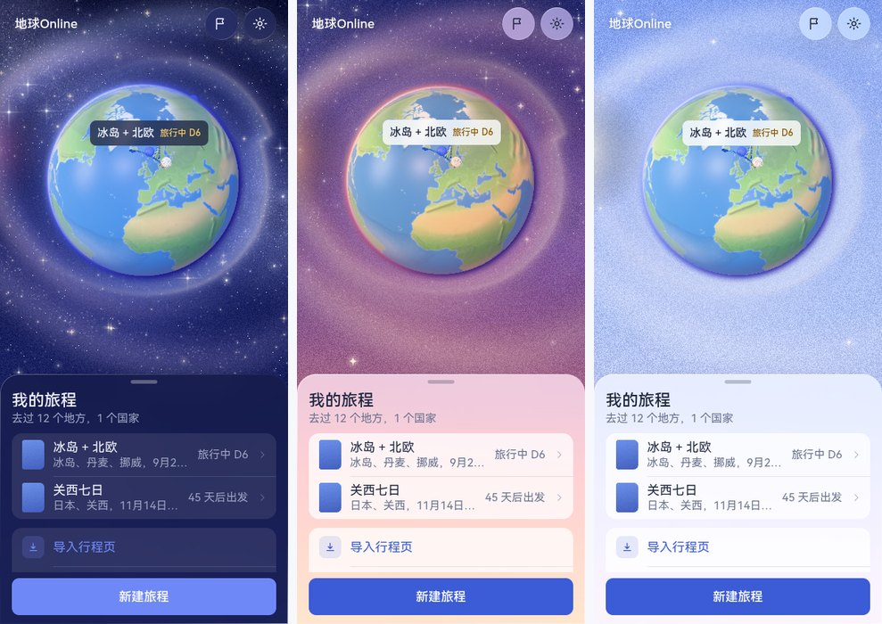

### 12.5 小人 v4：往潮玩靠

- **绒面**：布料在着色器里加一层「绒」：按视角的边缘柔光（发色 × 0.5 的自发光），加上程序化的针织、罗纹、尼龙绗缝、牛仔斜纹、皮革纹理（`app/shared/world/fabric.ts`，屏幕空间导数控制细节在远处淡出）。
- **脸**：豆豆眼（小、亮、偏低、分得开，两个高光）、一抹腮红、小鼻子、一道小弧线的嘴；不画雀斑、不画睫毛。默认短发（中性）。
- **性能**：部件网格在两个 Web Worker 里算（窄带距离场 + 四点梯度，整身约 3 秒不占主线程），着色器在后台编译好再显示。

### 12.6 景点分三级

| 级 | 覆盖 | 模型 | 界面 |
|---|---|---|---|
| 名胜 | 最出名的一批（登记表 `landmark-famous.ts`，按名字或坐标认） | 专门做的，接近真实外形、潮玩比例 | 图标 + 「名胜」 |
| 类型 | 其余绝大多数：六组约 30 种（下表） | 每种一个通用模型，种子决定颜色与小变化 | 类型图标 + 类型名 |
| 兜底 | 认不出类型的 | 路标石堆 + 一面小旗 | 定位图标 |

| 组 | 类型 |
|---|---|
| 人文 | 寺庙神社、清真寺、教堂、城堡宫殿、博物馆、剧院、遗址、纪念碑雕塑、桥、塔、广场市政、老街小镇 |
| 自然 | 间歇泉、温泉、火山地热、瀑布、冰川、海滩海岸、峡湾峡谷、洞穴、湖泊、徒步步道、森林公园、山 |
| 休闲 | 观景台、缆车、游乐园、动物园水族馆 |
| 吃喝购物 | 市场、餐厅咖啡、购物 |
| 交通 / 住宿 | 机场、港口、车站、住处 |

类型的来源依次是：条目里写明的 `kind` → 类别（住处、交通以类别为准）→ 地图数据标签（OpenStreetMap 的 tourism / historic / natural / amenity / religion）→ 名字关键词（中、英、北欧、日文，先具体后宽泛）→ 类别兜底。

**名胜模型的生产规格**（下一批见讨论记录待定事项）：

1. 参考：多角度公开照片 + OSM 建筑轮廓与高度。
2. 草模：Blender 按轮廓挤出、手调比例；也可以用图生 3D（TRELLIS、TripoSR、Hunyuan3D）出草模当比例参考，不直接用。
3. 风格化：倒圆角、合并小构件、高度夸张约 1.3 倍、每个模型不超过 5 种颜色（取自世界层色板）、统一绒面参数。
4. 规格：不超过 8 千三角面；不用贴图或只用 256 × 256 以内的色块贴图；glTF + meshopt 压缩；远景一级 LOD（约 1 千面）。
5. 登记：`landmark-famous.ts` 加一行（别名、坐标、半径、类型、模型名）。现在已做的 20 个是代码搭的，之后逐个换成 glb。
6. 验收：`hero-lab.html?lm=famous` 与 `?lm=kind` 并排看。

### 12.7 开源工具清单（细化与程序化建模）

许可以各项目仓库当前的说明为准。

| 用途 | 工具 | 许可 | 怎么用 |
|---|---|---|---|
| 建模、雕刻、烘焙、离线渲染 | Blender | GPL | 名胜模型与小人高模；Cycles 出关键视觉（第 9 节） |
| 真实感对照渲染 | three-gpu-pathtracer | MIT | 在浏览器里用路径追踪对照 three.js 实时效果 |
| 后期（景深、泛光、颗粒） | pmndrs/postprocessing、N8AO | zlib、CC0 | 移轴景深与环境光遮蔽的正式版 |
| 大气散射 | takram three-geospatial（atmosphere）、glsl-atmosphere | MIT | 地球大气的物理版（现在是简化的单次散射） |
| 网格压缩与打包 | meshoptimizer、glTF-Transform | MIT | 名胜 glb 的压缩、LOD、去重 |
| 展 UV | xatlas | MIT | 烘焙 AO / 色块贴图前自动展 UV |
| 程序化材质 | Material Maker | MIT | 绒面、针织、岩石的节点材质，导出小贴图 |
| 手绘贴图 | ArmorPaint | zlib（源码） | 名胜的色块与细节 |
| 人体基底 | MakeHuman / MPFB | AGPL / GPL（导出的资产 CC0） | 小人比例与姿势参考 |
| 低模素材 | KayKit、Quaternius | CC0 | 通用类型模型的参考与占位 |
| 图生 3D 草模 | TRELLIS、TripoSR、Hunyuan3D | MIT、MIT、腾讯混元社区许可（有地区与用途限制） | 名胜草模的比例参考 |
| 设计与文案 skill | frontend-design、humanizer-zh、ios-hig-design | Apache 2.0、MIT、MIT | 已装在仓库 `.claude/skills/`，见 `THIRD_PARTY.md` |

## 13. 第六轮：首页的阶段卡片、悬浮的新建按钮、折叠屏

> 仓库主人：尽量缩减除了主画面之外的其他的空间，只做适应内容高度的卡片和宽度的卡片。新建旅行的按钮，用我们刚刚的一些美化的部分做一下按钮的背景和样式，这个的视觉很重要，可以脱离下面悬浮在地球上。

### 13.1 首页只有三样东西

| 元素 | 位置 | 规格 |
|---|---|---|
| 悬浮图标组 | 右上，安全区下 10 | 一条玻璃胶囊里 4～5 个 44 × 44 的图标：全部旅程、导入、足迹与家、设置（旅行中多一个「＋」） |
| 阶段卡片 | 底部，左右 16 | 玻璃（`.lg.strong`），圆角 22，最宽 420，高度随内容；内容只有：一行状态（旅行中用晨色，出发用湖色）、标题 22、一行次要 15、必要时一行「下一站」、一个整宽主按钮 |
| 新建旅程 | 卡片上方、水平居中，悬浮在地球上 | 见 13.2；空闲时它就是首页唯一的操作 |

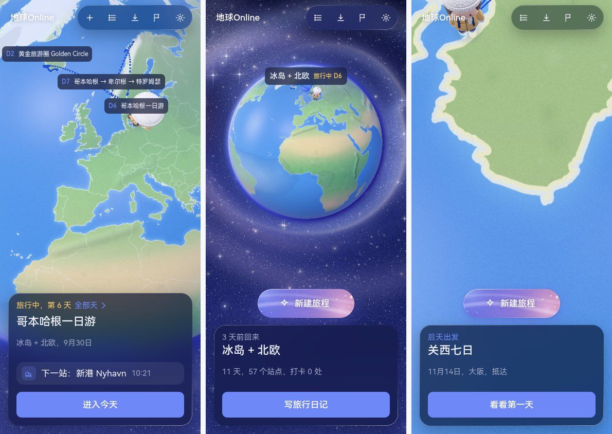

### 13.2 梦幻的新建按钮

- 尺寸：高 56、圆角 28、左右内边距 22 / 28，最小宽 188；图标（四角星）20 + 文字 17 / 600，白字加一层很淡的文字阴影保证在浅色处可读。
- 底：一小片地球外的宇宙（画布画，`backdrop-paint.ts` 的 `paintDreamButton`）：长春花蓝 `#5B6FE8` → 藕紫 `#8E7AD8` → 粉 `#D48FB0`，右下一团粉色柔光、左上一团蓝色柔光，两道星云弧，细颗粒，七颗小星，一枚四角闪光。平面、有沙画颗粒，不做立体的渐变。
- 边：和玻璃卡片同一种亮边（左上亮、右下淡的 1 px 渐变描边）。
- 光：柔和的紫色投影；每 6 秒一道很淡的光扫过（系统「减少动态效果」时不动）。

### 13.3 折叠屏

| 形态 | 尺寸（pt） | 排法 |
|---|---|---|
| 手机 / 折叠外屏（iPhone Duo 外屏约 466 × 678、阔折叠外屏约 421 × 616） | 紧凑 | 卡片与按钮在底部，地球在上方露出来的那块居中 |
| 展开（iPhone Duo 内屏约 890 × 626、阔折叠内屏约 861 × 609） | 展开 | 卡片、按钮在折痕左边那一半（宽 = 半屏 − 44），地球在右半居中；书与某一天的抽屉停靠在左半，高度随内容 |

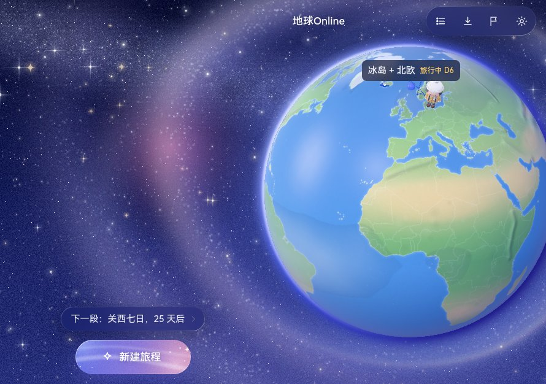

## 14. 第七轮：按钮精简、不用蓝色填充、和系统 App 一样的字

> 仓库主人：「现在部分按钮的样式太大了，我希望这里都尽可能的精简，然后不要用现在的这个蓝色的填充的风格，和整体的风格进行一下统一。」「字的显示跟普通的手机上的 App 字体显示不是很一致。」「减少大段文字的出现，要精简显示，只显示最关键的信息。」

### 14.1 按钮只有三种

| 种类 | 样子 | 用在哪 |
|---|---|---|
| 主按钮 | 墨色小胶囊：高 36、圆角 18、左右 16，字 15 / 600；白天深墨底白字，夜里白底深字；宽度随文字，点击区撑到 44 | 一屏最多一个：卡片右边的「进入」「查看」「写日记」、抽屉标题右边的「进入今天」、表单右下的「创建」「导入」 |
| 次按钮 | 玻璃小胶囊：同尺寸，浅填充（`--c-fill`）+ 墨字 | 「全部加入」、某一天的「加站点 / 交通 / 住宿」 |
| 文字按钮 | 只有字，次墨色（`--c-ink2`） | 返回、「重写」、导航栏右边的「导出长图」 |

- 不再有整宽 50 高的按钮；不再有湖色（蓝）实心或浅蓝底。湖色只留在文字、路线和选中的小图标上。
- 选项小块（主题、搜索建议）和分段控件一样：未选是浅填充，选中是墨色。
- 列表行前的图标不再放在蓝色方块里，只是一个 18 的线性图标；天数（D2）只是文字。
- 「新建旅程」仍是梦幻底，但小一号：高 44、字 15。
- iOS 版同一套：`InkCapsuleButtonStyle`（`GlassComponents.swift`），主按钮靠右。

### 14.2 字：手机上用系统字体

| 设备 | 字体栈 | 结果 |
|---|---|---|
| iPhone / iPad / Mac | `-apple-system, "PingFang SC"` | 拉丁字母和数字是 SF Pro，汉字是苹方，和系统 App 一模一样 |
| 鸿蒙（华为 / 荣耀） | `"HarmonyOS Sans SC", system-ui` | 系统的 HarmonyOS Sans |
| 其他（桌面、安卓） | 苹方 → HarmonyOS Sans → 随包 App Sans | 只有这里才下载随包字体 |

以前中文栈把苹方放第一位，苹果设备上的数字和英文也用苹方的拉丁字形，和系统 App 不一样；鸿蒙浏览器认不出 "HarmonyOS Sans SC" 这个名字，会去下载 8 MB 的随包字体，加载完再换一次字。现在按设备选（`shared/world/tokens.ts` 的 `detectPlatform` 与 `fontFamily`，调试加 `?platform=apple|harmony|other`）。字号仍是四个（22 / 17 / 15 / 12），卡片标题从 22 降到 17。

### 14.3 只显示最关键的信息

| 地方 | 以前 | 现在 |
|---|---|---|
| 首页卡片 | 状态、标题 22、书名与日期、下一站一块、整宽按钮 | 状态、标题 17、一行要点（下一站与时间），右边一个小胶囊；点左边看全部天 |
| 刚回来 | 加一行「11 天，57 个站点，打卡 0 处」 | 不列统计，统计在日记页 |
| 书的抽屉 | 标题、目的地与日期、状态、总里程与自驾时长一行、底部整宽按钮 | 标题、日期与状态一行；「进入今天」在标题右边；天的行只有标题与日期 |
| 某一天的抽屉 | 日期、路上里程、用时、住处 | 只有日期；站点行只有名字和时间，路段只有交通图标和用时 |
| 新建旅程 | 语音入口两行、标签式页签、9 个两行的建议地名、每个输入框上的标签 | 语音入口一行；分段控件；输入后才出现最多 5 个地名；目的地与书名只用占位文字 |
| 设置 | 每组下面一段说明 | 只留最后一句「旅程和足迹只存在这台手机上」 |
| 旅行日记 | 6 格统计、每天一个大文本框、底部整宽导出按钮 | 4 格统计；每天两行预览，点开才编辑；「导出长图」在导航栏右边 |

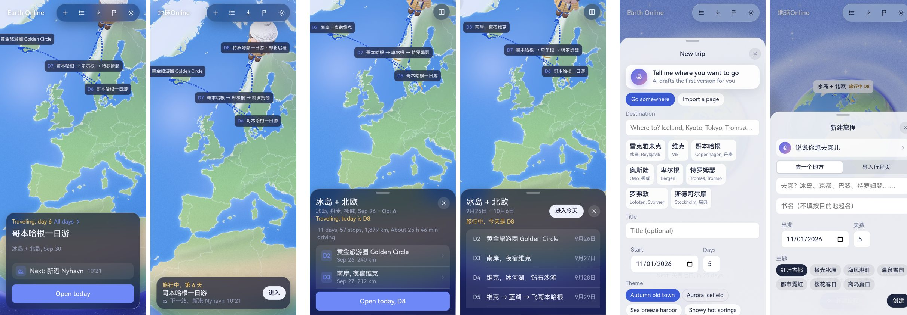

## 15. 第八轮：去色、弹层精简

> 仓库主人：「现在很多的高亮色和主题色是那个蓝紫色，我不喜欢这个颜色，要不就先都改成白色或者是黑色先去色处理？」

判断见讨论记录 D56–D59。这里记规格。

### 15.1 色卡：没有强调色了

| 角色 | 白天 | 夜里 | 用在哪 |
|---|---|---|---|
| 墨 | `#1E2640` | `#EEF0FA` | 正文、图标、主按钮、选中、地球与浮岛上的路线和针 |
| 墨 · 次 | `#444C6A` | `#C9CDE0` | 文字按钮、素图标按钮、标签字 |
| 雾 | `#565E7C` | `#9AA1BF` | 次要文字、未选中的图标 |
| 晨（高亮） | `#F0B03A` | `#F5BE4E` | 只给「现在」（今天、旅行中）与「去过」（足迹旗、打过卡）；浅底上的晨字 `#754A00` / `#F5C766` |
| 警示 | `#BE3A52` | `#F07083` | 只用于删除 |

白天的四个值是 15.9 校准后的；校准前雾 `#6B7390`、墨 · 次 `#4A5270`、晨字 `#8C5A00`、警示 `#D14B5E` 在玻璃上都不到 4.5。

- 令牌 `lake` / `lakeSoft` / `lakeDeep` 保留名字，值改成墨的三档（夜里白的三档）；色卡页上它们叫「强调 / 浅强调 / 深强调」。旧样式里的 `--accent`、`--ok` 映射到同一处，所以没改到的角落也不会再冒出蓝。
- 地球上的路线、站点针：白天墨、夜里白（`globe-data.ts` 按 `html[data-theme]` 取色，换天色时重画）。住处、机场、港口的针一直是墨。浮岛上的站点针与住处针也是墨，三套色调一样。
- 「新建旅程」的梦幻底：白天是一小片墨色的夜空（深墨 → 石板 → 雾，白色的星云弧与小星，白字），夜里反过来是纸色（纸 → 浅雾，墨色的弧与星，墨字）。颗粒与两道弧的笔触不变。
- 世界层不动：地球外的天色（长春花蓝 → 淡丁香、晨昏的橘红、夜的藏青）、海、陆地、晨色都还在。这是「先去色」的范围：界面的强调色。
- iOS：`Lake` 与 `AccentColor` 两个色集改成墨 / 白；`DreamyCapsuleButton` 按浅色 / 深色外观切两版底。

### 15.2 弹层只有四样东西

| 弹层 | 以前 | 现在 |
|---|---|---|
| 站点详情 | 四行键值（计划到达、预计、怎么去、底板位置）、带标签的备注框、四个并排按钮 | 一行类型与时间（09:00 – 10:30），一行怎么去（图标、方式、用时），备注框，底下一排：删除（文字、警示色、靠左）、编辑、走过去（文字）、打卡（墨色小胶囊） |
| 足迹与家 | 两块灰底的区块、三格统计、小按钮 | 两组分组列表：家一行（右边「清除」）+ 搜索框 + 两个玻璃小胶囊；去过的地方一行小结（几个地方，几个国家，最远多远）+ 按国家分组的行（名字，日期与书名）+ 补一个地方 |
| 头像 | 带标签的名字框、两个下拉、五排色块、一段说明 | 名字框（占位文字）、发型与帽子是分段控件、五排色块；没有说明 |
| 语音面板 | 标题 22、话筒 88、空闲时一行「点一下开始说」 | 标题 17、话筒 72、空闲时没有状态行；听的时候才有「正在听」 |
| 付费页 | 权益每行两句、整宽的主按钮、两句小字 | 权益每行一句、墨色小胶囊、一行小字（「试用结束后每年 ¥88，随时可取消；不订阅也能看和导出已有行程。」） |
| 示例行程库 | 书名 + 一段介绍（可换行） | 书名 + 一行介绍（截断） |

规则：一个弹层 = 标题 + 一两行列表 + 至多一个输入框 + 一排小按钮；主按钮至多一个，靠右；删除是文字按钮，靠左。

### 15.3 iOS 跟着网页

- 首页卡片：左边三行（状态、标题 17、一行要点），右边一个墨色小胶囊（进入 / 查看 / 写日记）；刚回来不列统计。
- 书：日期与状态一行，不再列总里程与自驾时长；天的行只有标题与日期。
- 某一天：只有日期；下一站一行（类型图标、名字、时间）；站点行只有名字和时间；路段只有图标和用时。
- 足迹、付费墙、设置、日记里的说明段删掉或缩成一句。

### 15.4 各大洲名胜核对

`hero-lab.html?lm=famous&region=nordic|asia|europe|africa|americas|oceania` 六页并排看（`app/docs/r8_landmarks_*.jpg`），按三条看：尺度、配色、能不能一眼认出来。

| 页 | 结论 |
|---|---|
| 亚洲（32） | 一致。塔类（东京塔、晴空塔、东方明珠、台北 101、双子塔、哈利法塔）都在 5 个单位以内；山水摊开（富士山、黄山、漓江、下龙湾、珠峰）；朱红（鸟居、郑王庙）、金（故宫、天坛、金阁寺）、青灰（现代塔）各成一组。晴空塔原来是白色格构，浅底上看不见，塔身与格线压深一档。 |
| 欧洲（30） | 一致，也是最细的一页：埃菲尔铁塔、大本钟、斗兽场、圣家堂、蓝色清真寺、米兰大教堂都一眼能认；配色克制（米白为主，红顶、蓝顶点一下）。 |
| 美洲（19） | 一致。自由女神、金门大桥、白宫、好莱坞标志、马丘比丘、复活节岛石像都能认；大峡谷、纪念碑谷用同一组橙红岩层色。 |
| 非洲（8）、大洋洲（7） | 模型本身没问题（桌山、维多利亚瀑布、乞力马扎罗、哈桑二世清真寺、海港大桥、乌鲁鲁、大堡礁、米尔福德峡湾），是实验页的取景按行数算，一两行时装不下六列，被切掉了；取景改成按行列里更宽的那个算。 |
| 北欧（20） | 第一批，最粗。辛格韦德利（几块绿方块）、黑沙滩（一排黑圆柱）、钻石冰沙滩（黑板上几颗方冰）、Vigeland（一根柱子）、阿美琳堡与玫瑰堡（同一个宫殿模板）、新港与 Bryggen（同一排彩房）要按亚洲、欧洲的细度重做。 |

规格不变（12.6 节）：潮玩比例、不超过 5 种颜色、塔类 1.3 倍夸张以内、不超过 8 千三角面。

### 15.5 通用操作用图标按钮

| 操作 | 图标 | 在哪 |
|---|---|---|
| 编辑 | 铅笔 | 站点详情、条目工具行 |
| 删除 | 垃圾桶（警示色） | 站点详情、条目工具行 |
| 清除 | × | 足迹与家的「家」一行 |
| 重写 | 环形箭头 | 旅行日记每一天 |
| 导入 / 导出 | 托盘向下 / 向上的箭头 | 全部旅程、旅行日记的导航栏 |
| 上移 / 下移 | 箭头 | 条目工具行 |
| 取消 | × | 行内表单 |
| 勾选 | 空心圆 / 带勾的圆 | 待办 |

规格：32 的圆、浅填充墨色图标（`.ibtn`），工具行里 28，透明底的用次墨色（`.ibtn.plain`），删除用警示色底（`.ibtn.danger`）；点击区撑到 44；都带 `aria-label`。只有「走过去」「插交通」「前一天 / 后一天」这种不通用的还是文字。iOS 是 `IconButton`，同一套尺寸。

### 15.6 行程列表的图标：交通一种、住宿一种、站点按六组

| 组 | 图标 | 覆盖 |
|---|---|---|
| 交通 | 两点一线（route） | 所有交通段，机场、港口、车站 |
| 住宿 | 床 | 住处 |
| 人文 | 柱廊 | 寺庙神社、教堂、城堡、博物馆、遗址、桥、塔、广场、老街…… |
| 自然 | 山 | 瀑布、冰川、海滩、峡湾、湖、森林、山、温泉、火山…… |
| 休闲 | 摩天轮 | 观景台、缆车、游乐园、动物园 |
| 吃喝购物 | 餐具 | 市场、餐厅咖啡、购物 |

书的天列表、某一天的条目与时间轴、下一站、站点详情、地球上的机场 / 港口标签都照这张表；类型级的图标（教堂、瀑布……）只在选类型的编辑器里用。类型名仍在标签里写清楚（「教堂」「名胜」）。

### 15.7 「新建旅程」：唯一带颜色的按钮

- 底：蜜 `#F6D58C` → 晨 `#F0B84A` → 琥珀 `#E6A032`，只有晨色一个色相；白色的星云弧与小星，颗粒；夜里深一档（`#EBC25E` → `#DFA53C` → `#CF8E2C`）。
- 字与图标：墨 `#1E2640`，不加投影；对比度 6.7:1 以上，夜里 5.4:1 以上。
- 阴影：琥珀色的柔光。高 44，圆角 22。
- 第一版是晨金 → 杏 → 珊瑚（像日出）。仓库主人看了说不和谐：珊瑚那一端是红，放在长春花蓝的天上是硬碰硬的互补色。把五个候选（现在的、单一色相的晨、更淡的砂金、近乎暖白的月白、不带红的杏仁）并排放在真实的天色、地球外的底色和夜色上比，单一色相的晨最稳：和「现在」的标签、小人的外套是一家，在天上像太阳而不是一块橘红。

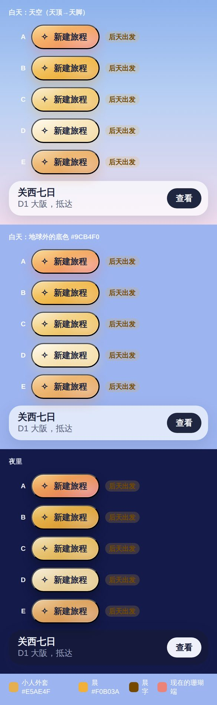
- 其余按钮不许带颜色：主按钮墨色小胶囊，次按钮玻璃，再次文字，通用操作图标。

### 15.8 文字分四层，同一类信息用同一种标签

（字号在 15.11 收成了两档：标题 17 / 600，正文 17，次要 13，标签 13 / 600。下表是第八轮中段的版本，层的划分仍然成立。）

| 层 | 规格 | 例 |
|---|---|---|
| 标题 | 17，600（15.11 之前是 22） | 卡片标题、抽屉标题、站点名 |
| 正文 | 17，400 | 行的第一行 |
| 次要 | 13，400，雾色（之前 15） | 行的第二行、日期、用时 |
| 标签 | 13，600，高 20 的小胶囊；浅填充次墨字，「现在」用晨色（之前 12） | 旅行中第 8 天、后天出发、计划中、D2、教堂、名胜、10月5日 前、省 39%、自驾、行程 2 / 3、14 个地方 |

规则：一个地方的同一类信息都用标签，不用散落的小字；一行里标签不超过两个；标签不做按钮（可点的是整行）。iOS 是 `TagView`。

待办的提示也照这个规则，而且跟着站点走：站点行的名字旁一个带勾的数量标签（`.tg.todo-tg`），第二行写最近要做的一件；书的抽屉顶上与首页卡片不再汇总整本书的待办。

### 15.9 校准：对比度算到玻璃上、焦点环、点击区

仓库主人要求用设计类的 skill（无障碍检查、设计美学）给整体做一次校准。用 `frontend-design`（审美与克制）与 `ios-hig-design`（HIG 的六问 + 原生习惯）两个 skill 过了一遍网页参考应用与 iOS 工程，数字用脚本算：把半透明的表面（玻璃 0.46 / 强玻璃 0.68 / 抽屉 0.9 + 列表 0.62 / 浅填充 0.08）依次叠在玻璃后面可能出现的底色上（海 `#5A96D6`、陆地 `#8FBF76`、天中 `#B9D0F3`、天脚 `#EFDCEC`），再按 WCAG 2 算文字对底的比值，取最差的一个。

**对比度（白天）** 夜里的一套本来全部 ≥ 4.5（最差 5.3），只有雾 · 浅做占位不够，和白天一起改。

| 文字 / 底 | 校准前（最差 → 最好） | 校准后（最差 / 天中） | 改了什么 |
|---|---|---|---|
| 雾 15，次要行 / 强玻璃卡片（首页卡片、抽屉头） | 2.7 → 4.1 | 4.6 / 5.6 | 雾 `#6B7390` → `#565E7C` |
| 雾 15 / 抽屉里的列表 | 4.4 | 6.0 | 同上 |
| 墨 · 次 15，文字按钮与素图标按钮 / 普通玻璃 | 4.35 | 4.8 / 6.7 | 墨 · 次 `#4A5270` → `#444C6A` |
| 标签 12 / 600 / 浅填充 / 玻璃 | 3.8 | 5.3 / 6.4 | 同上 |
| 「现在」标签 晨字 / 晨填充 / 玻璃 | 3.2 | 5.2 / 6.1 | 晨字 `#8C5A00` → `#754A00` |
| 旅行中第 n 天 晨字 15 / 玻璃 | 3.3 | 5.5 / 6.7 | 同上 |
| 删除文字 15 / 抽屉 | 3.7 | 4.6 / 4.9 | 警示 `#D14B5E` → `#BE3A52` |
| 输入框占位 | 2.3（雾 · 浅） | 6.4 | 占位改用雾；雾 · 浅只剩禁用态与装饰 |
| 焦点环 / 玻璃 | 1.5（旧规则：晨色 3px） | 8.4 / 11.8 | 统一成墨色 2px、外扩 2px（夜里白） |
| 「新建旅程」墨字 / 最深那一端 | 5.75（珊瑚；夜 4.8） | 6.7（琥珀；夜 5.4） | 见 15.7，换色是为了和谐，对比顺带更好 |
| 主按钮 纸字 / 墨底 | 14 | 不变 | — |

四个颜色改在 `tokens.ts`，网页与 iOS 的色板（`DawnInk`、新加的 `Ink2`）同时改；三层灰（墨 / 墨 · 次 / 雾）之间的级差变小了一点，但仍能分出来，层级靠字号与字重，不靠颜色硬拉开。

**点击区（≥ 44）** `.btn` 36 高本来就外扩到 44。补的：`.ibtn.sm`（28 → 44）、`.fab.sm`（32 → 44）、抽屉的关闭按钮（32 → 44，✕ 字符换成图标）、分段控件 / 候选小胶囊 / 搜索建议（32 高，上下各补 6）、空闲首页的小卡片与足迹小胶囊（40 → 44）。iOS 的 `IconButton` 与翻天按钮本来就是 44。

**读屏** 某一天右上角 6 个只有 `title` 的图标按钮补了 `aria-label`；提示条的容器是 `role="status"` + `aria-live="polite"`；抽屉、付费页、语音面板本来就是 `dialog` + `aria-modal`，焦点先落在卡片上。

**动效** 网页的星空、新建按钮的流光、全局过渡都已尊重 `prefers-reduced-motion`；iOS 这次把语音按钮的涟漪与随音量的缩放也挂到「减弱动态效果」上。

**iOS 按 HIG 六问自评**（没编译，看代码）：安全区（卡片在 `VStack` 里，只有世界层 `ignoresSafeArea`）、44 点击区、深色外观（色板 Any / Dark 两套）、动态字体（全部语义字阶；标签这次改成 `minHeight: 20`、符号用 `caption2`，不再裁字）、VoiceOver（图标按钮都有标签，行合并成一个元素）、原生导航（底部抽屉与 sheet，没有汉堡菜单）六项都满足；原生习惯四项里语义色（标签字改用色板里的 `Ink2`，而不是 60% 的 `secondary`——12 号半粗的小字在白底上只有 3.4）、系统控件、SF Symbols 满足，触觉反馈只在语音与打卡上有。自评 9 / 10，差的一分是 Dynamic Type 最大档没有真机验证。

**审美上的克制（frontend-design 的清单）** 全应用只有「新建旅程」一个带颜色的元素，其余墨与白；没有全大写、没有字间距、没有装饰性的编号（D1 / D2 与站点的 1 / 2 / 3 都是真的顺序）；非用户触发的动效只有新建按钮那一道流光；并列信息中文用「，」、英文用「, 」，不用「 · 」串起来。这一遍没有再动版式。

### 15.10 行程从上往下有顺序；站点详情只留入口

仓库主人看图后的两条要求：「行程按照从上往下排列，要有一个顺序」「备注变成一个添加、待办点进去再看，都不要作为默认选项显示在外面」。

**顺序** 书里一天的站点行、某一天的站点条，左边是序号：22 的墨底白字小圆（打过卡的是晨色），和浮岛上的针用同一个号；列表左侧一条 2px 的细线（`line` 色）把序号从上串到下，交通那一行缩进在线的右边。组图标没有丢，挪到名字前面（14 / 13，墨 · 次色）。iOS `StopRow` 给了 `index` 就照此显示；编辑列表（可拖动排序）不编号。

**入口行** 站点详情只剩四样：一行类型标签与时间、一行怎么去、一行「待办」、一行「备注」。待办那一行带数量标签与最近一件，点开是待办自己的抽屉（每行一件 + 添加行）；备注那一行没有备注时是墨 · 次色的「添加备注」，有备注就显示那一句，点开是备注的抽屉（输入框 + 「完成」）。两行都是整行可点、高 44、右边 chevron。iOS 是同样的两行入口加两张 sheet（`FittedSheet`）。

### 15.11 字号只有两档：17 与 13

仓库主人看某一天的页面说「大小字体不一的情况比较严重」，让先调研手机 App 到底用几个字号，如果基本统一就只留两档。

**调研**

| 体系 | 字阶有多长 | 一屏列表页实际用几档 |
|---|---|---|
| Apple HIG（Dynamic Type 默认档） | 11 个文字样式：Large Title 34、Title1 28、Title2 22、Title3 20、Headline 17 粗、Body 17、Callout 16、Subheadline 15、Footnote 13、Caption1 12、Caption2 11；最小 11 | 邮件：17 发件人 + 15 预览与日期；设置：17 行 + 13 脚注；日历、备忘录同理。内联导航标题是 17 粗，和正文同号只换字重；大标题 34 是可选的 |
| Material 3 | 15 个角色（Display / Headline / Title / Body / Label × L / M / S），Material 3 Expressive 到 21 个 | 列表项：Body Large 16 + Body Medium 14（徽标 Label Small 11）；官方的说法是「太多字号会毁掉版面」 |
| HarmonyOS（没搜到官方页，按记忆） | Body 16 / 14，Caption 12 | 列表页 16 + 14 |
| 国内常见 App（按记忆） | 微信 17 / 14，支付宝 16 / 13 | 两档 |

结论：字阶长是给整个系统备用的，一屏之内都是两档，第三档只有「大标题」，而 iOS 把它做成可选。我们之前一屏里 22 / 17 / 15 / 12 四档并存，确实不统一。

**规则**

- 只有 **17 / 22** 与 **13 / 18** 两档。标题也是 17，用 600；正文 17 / 400；按钮 17 / 600；次要 13 / 400；标签 13 / 600。
- 层级靠字重（600 / 400）与三级颜色（墨 / 墨·次 / 雾），不靠字号。
- 令牌名不动：`title` 与 `headline` 现在同档，`sub` 与 `caption` 同档，所以 CSS 变量与 iOS 的 `Font` 扩展一改全改。iOS 对应 `.body` 与 `.footnote`。
- 输入框一律 17（iOS Safari 对小于 16 的输入框会放大页面）。

### 15.12 行内图标与标签的对齐：一个 middle

错位的根源有两个：四档字号下每处都在手调 `vertical-align`（−2px、1px、2px、4px 各一套）；某一天的条目里，名字前的组图标（`svg.ic`）被第三轮条目样式 `.entry .ic`（序号圆：20 的墨底白字）误套，变成一个黑圆压在名字上。

现在：字号只有两档，行内的图标与标签一律 `vertical-align: middle`（再整体上提 1px 贴 CJK 的视觉中线），不再逐处调；某一天的条目换成了和书里一样的列表行（15.13），旧样式不再参与。

### 15.13 间距一把尺；某一天的抽屉只剩两样

**间距**只用 4 / 8 / 12 / 16 / 24：行的左缩进 16、右 12；图标槽 28，到文字 12；行内图标到文字 8；标签之间 4；卡片与抽屉内距 16；按钮之间 8。之前散落的 5、6、7、9、10、14 都收到这一把尺上。

**某一天的抽屉**（仓库主人：「整体的信息排版还是太乱了」）：

- 之前：标题 + 日期 + 翻天按钮、「下一站」卡、一条时间轴、「行程」小标题、自己一套样式的条目（名字 15 粗、时间 15 粗、状态 12、每行一个「⋯」）、底部「添加站点 / 添加交通 / 添加住宿」三个小胶囊。一屏四档字号、三种列表样式。
- 现在：标题行、「下一站」一行、**和书里一样的行程列表**（序号、组图标、名字、状态与待办的标签、右边时间；交通缩进一行；到了的名字变雾色、打过卡的序号圆是晨色、正在这一站的行有一层浅底），底部一排：编辑态开关（图标按钮，开了每行右边才出现上移 / 下移 / 编辑 / 删除）+「添加」（站点 / 交通 / 住宿三选一）。表单在自己的抽屉里。时间轴条、小标题、「⋯」都去掉了。
- 站点详情底部的「走过去」改成「导航」（D72）：四家地图 App 任选，小人走到这一站仍然是点列表那一行。

### 15.14 每一趟旅程都是一张票

仓库主人发来一张 Three.js 撕票动画的截图（橙色纸票，ADMIT ONE，撕票根），说「把每次行程做成 ticket 的样子」，然后补了三句：白底黑字；整体文字简洁；地点大标题加粗。

**票长什么样**

- 纸：纯白，加一层细颗粒（按旅程的 seed 各不相同），右上角一片很淡的墨色晕像纸的厚度。白天夜里都是白纸墨字——票是物件，不随外观换色。
- 形：四角各一个半径 10 的缺口，撕线的上下各一个半径 7 的小缺口；右边一截 76 宽的票根（小票 56）隔着一条虚线。网页用 `mask-image` 挖缺口，iOS 用 `Path.subtracting`。投影跟着缺口走（`filter: drop-shadow`）。
- 字：一行印章式的小字「地球ONLINE · No. 0007」（等宽 13，大写，字距），右边是状态标签；大标题是**地点**，22 / 700；底下一行等宽 13 的小字是书名与日期，旅行中换成「D8 · 今天的标题」。票根竖着印「凭票进入」（列表里的小票印天数），底下一个很淡的年份水印。
- 动：撕票根 = 进入。票根以左下角为轴转着飞出去（0.55 秒），票面轻轻往左一顿，然后才切页面；「减弱动态效果」开着就直接走。

**用在哪**

| 地方 | 票 | 票面 | 票根 |
|---|---|---|---|
| 首页 · 旅行中 | 大票 | 标签「旅行中，第 8 天」、地点、「D8 · 今天的标题」 | 凭票进入 → 潜进今天 |
| 首页 · 要出发 | 大票 | 标签「后天出发」、地点、「D1 · 第一天」 | 查看 → 翻开这本书 |
| 首页 · 刚回来 | 大票 | 标签「欢迎回家」、地点、书名与日期 | 写日记 |
| 首页 · 空闲 | 小票 | 标签「12 天后出发」、地点、书名与日期 | 天数（不可点） |
| 书的抽屉头 | 大票 | 状态、地点、书名与日期 | 进入今天 / 进入 |
| 全部旅程（弹层与只看列表页） | 一摞小票 | 状态、地点、书名与日期 | 天数 |

点票面一律是翻开这本书。首页原来的玻璃状态卡与「下一段」小胶囊都退役了。

**票不放在卡片上**（仓库主人看图后的要求）：书的页面里票浮在抽屉上方，随抽屉的高度挪，抽屉只装天的列表；左上一个「回到地球」的玻璃圆按钮。iOS 同样是票在卡片上方。

**字**：汉字一律还是正文字体（苹果 SF + 苹方，鸿蒙 HarmonyOS Sans），等宽只给票号、年份这类数字与拉丁。截图里之前一直像「英文字体配汉字」，是截图容器（无头 Linux）没有苹方与 HarmonyOS Sans、拿 DejaVu Sans 配文泉驿的缘故；现在容器里把苹果的字体名指向随包的 HarmonyOS Sans SC，真机上的字体栈没动。

**和规矩的关系** 票面上的等宽、大写、字距、「·」是印刷品的语汇，只许出现在票上；界面文案的两档字号、不用全大写、不用中点串照旧。书的隐喻没换：票是进书的凭证，翻开还是一天一页。

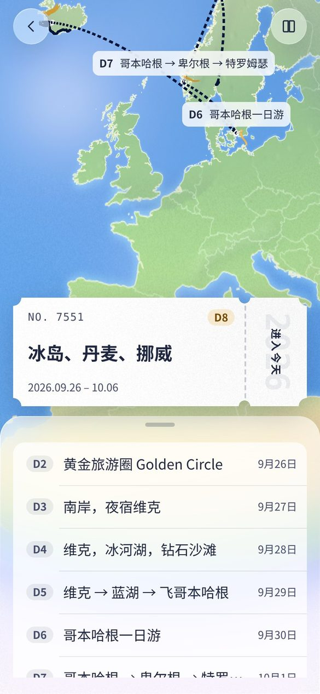

### 15.15 行李箱：一趟旅程走完，总结成一只打开的箱子（世界层里的 3D）

仓库主人发来一张「让 AI 帮你把箱子装满」的图：打开的铁皮箱，里面整整齐齐摆着这个人的东西。第一版照着做成了平面的画布（票、护照、登机牌、明信片按格子平铺），仓库主人看后定了方向：**箱子里放的是立体的东西——我们之前做的 3D 建模（名胜小模型）和当旅行地特色的东西，不是「对应的」票根那类平面物；再把这次旅行的穿搭小人也放进去。**所以 D78 推倒重来：箱子是世界层里的真 3D（three.js），网页与 iOS 用同一只。

**里面有什么**（`shared/algo/suitcase.ts` 的 `caseContents`）：
- 每天一座**名胜小模型**：某一天的世界里站点用的就是这批模型（`landmarks.ts`，名胜有专门的、其余按类型），箱子里按天各挑一座——名胜 > 认得出类型的 > 兜底，景点类别优先，去重，最多 6 座（超了先留名胜，再按天）。
- 目的地每一段一样**特色物件**（`shared/world/souvenir-models.ts`，按国家，最多 3 样）：日本是达摩，冰岛是海鹦，丹麦是蓝色曲奇铁盒，挪威是棕奶酪加奶酪刨，瑞典是达拉木马，法国是摞着的马卡龙，德国是姜饼心，荷兰是一双木鞋，西班牙是架子上的火腿腿，瑞士是巧克力加三角棒，加拿大是枫糖浆瓶，新西兰是蜂蜜罐……29 个国家，用 landmark-kit 的积木拼，和名胜是一套潮玩比例；国家对不上的（「关西」「北欧」）给一袋零食，颜色按名字定。名字表仍在 `shared/geo/souvenirs.ts`（给界面下面那行说明用）。
- **这趟穿搭的小人**：`hero.ts` 的小人，穿这趟的外套或连衣裙（`outfitFor`），站在上半箱里，面朝镜头，待机时轻轻呼吸、眨眼。
- 一本**厚日记**：墨色封皮、晨色松紧带、奶油色页边，立着稍微后仰，旁边一支笔。

不放票、登机牌、明信片、护照这类平面的「对应物」。

**怎么摆**（`layout`）：硬壳箱两半平放，合页在中间；靠镜头的下半放名胜（1 座居中，2～4 座两列，5～6 座三列，最后一行没排满就居中），上半左边站小人，右后一排特色物件，右前日记。每样东西按自己的高度与占地缩到合适的大小（名胜最高 1.9，物件最高 1.15，小人 1.8 左右），再各自随机转一点点。

**怎么画**（`shared/world/suitcase-scene.ts`）：箱体是沙色硬壳（清漆）、墨色拉链沿口与护角、浅灰里衬、两片合页、下半靠镜头的两角有轮子、右侧提手上挂一枚晨色行李牌。打光与小人实验台一致（半球光 + 带阴影的太阳 + 轮廓光 + 环境贴图），地面只接阴影（界面里箱子浮在页面的底上）。相机从正前上方 52° 俯看，竖幅 4 : 5，拖一下可以左右各转 35°。导出按 1080 × 1350 重渲一帧（纸色底）。日记页顶上就是它，底下一行小字写箱子里有什么，旁边一个导出的图标按钮。

**iOS**：同一只箱子——嵌入页新增 `show-suitcase`（带这本书与小人的穿搭）与 `export-suitcase`（回 `suitcase-image`，dataUrl）两条消息，`Screens/Diary/SuitcaseWebView.swift` 用一个独立的 WKWebView 装嵌入页（和世界层同一份 World/ 目录、同一个 scheme），放在 `DiaryView` 顶上；导出走消息拿回 PNG 给分享面板。原来 SwiftUI Canvas 画的平面版删掉了。还没编译过。

**打磨（D79）**：名胜与物件按量出来的包围盒放大（名胜最高 2.3、物件 1.6、小人放大 8%），外壳四面墙加硬壳箱的竖肋纹（比壳色深一点，合并成一个网格）。名胜下面曾经垫过一块小底板，仓库主人看后去掉了：「每个部分不要底板，就像物品直接放在行李箱里一样。」东西都直接放在里衬上。

**让 AI 装箱（D79）**：装完名胜、特色物件、小人与日记，再加最多三样小东西，放在上半前排、日记左边：保温杯、墨镜、相机、登山鞋、游泳圈、纸地图、望远镜、围巾、折叠伞、小玩偶（`shared/world/extra-models.ts`，同一套积木）。怎么挑：先按本机规则（`shared/algo/pack-extras.ts`）——从行程算一份摘要：季节、最北的纬度、各类站点的个数、名胜数、交通段数、这个人走过几趟——冷就保温杯（追极光另有一句），有海滩或温泉就游泳圈，山路多就登山鞋，名胜三处以上就相机，夏天海岛就墨镜，自驾三段以上就纸地图，看风景看动物的地方多就望远镜，樱花季的日本就折叠伞，第三趟起带上小玩偶；每样一句为什么，三种语言。有规划服务地址就再问一次 `/v1/pack`（同一个模型、低 effort、结构化输出；候选只能是画得出来的那几种），回来换掉规则挑的。箱子下面一行小字：「还帮你装了：保温杯（追极光的夜里冷）、游泳圈（有海滩或温泉）、登山鞋（要走山路）」。

**物件库（D80）**：特色物件按国家一组、每样一个 id（`shared/geo/souvenirs.ts` ↔ `shared/world/souvenir-models.ts`），76 样、64 个国家；目的地写了同一个国家的两段就依次拿第二样、第三样（「日本、关西」是达摩加招财猫），国名与常见城市名的中英日都认。「AI 加的」20 样（`extra-models.ts`）。实验台 `hero-lab.html?lm=case` 把库里所有东西排成一格一格：

**样式（D81）**：四款，定下来的，可选：沙色硬壳（默认）、墨色硬壳、帆布箱（皮角、皮带、铜扣，哑光）、复古木箱（横板条、铜边、铜钉、暗红里衬）。晨色的行李牌四款都有。选项存在小人的档案里（我的箱子），日记页箱子下面一排色块点一下就换。

**自己加减（D82）**：箱子旁边的「增减」按钮打开一排小标签，点 × 拿出来（拿掉就是拿掉，不用别的补位）；「从库里挑一样」把库里任何一样放进来；「放一张照片进去」抠出主体做成一张立牌（背后一根小支架），背景太复杂就整张做成拍立得；「恢复默认」。照片卡放在上半前排、AI 加的前面，一共最多三样。图存在设备上，书里只记尺寸。iOS 的抠图用 Vision，更准；网页是本机的漫延法。

**质感（D83）**：参考星空设计工作室「情绪治愈师」那组——哑光、渐变、玻璃、圆润。做成一道上色工序 `shared/world/look.ts`：哑光是软胶玩具的面（粗糙 0.55～0.8，一点绒光，几乎没有清漆）；渐变是整件东西从上到下一道柔和的明暗，烤进顶点色（乘法，黑的还是黑，顶上微暖、底下微冷）；玻璃是罐子瓶子换成真正的透射玻璃，眼睛鼻子那类又黑又亮的小点换成清漆亮球；铜银保留金属度加清漆；圆角盒默认圆角大一点。箱子里的东西和全家福都过这道工序，小人不过（有自己的布料着色器）。颜色要鲜：烤渐变时先提一点饱和（糖果色，不是灰扑扑的），色调映射用中性的而不是 ACES（ACES 把饱和色压灰），曝光略高、太阳略强；仓库主人看了第一版说「现在颜色看起来有点暗淡」，就是这么改过来的。

**还差的**：真机上看肋纹与皮带的尺度；网页抠图换成真正的分割模型（现在只认得出干净的背景）；照片卡可以写一行字（label 已留）；这道质感工序以后也给某一天的世界里的名胜用（先看性能）。

### 15.16 清单：类 emoji 的物件图标，一句话检索、按组摆（D84）

仓库主人发来一张小红书视频的截图：博主用「jev」模型做的打包清单——一个搜索框（「国庆去韩国玩7天」）、三枚场景标签、下面一格一格 Apple emoji 样的东西。「尝试使用 jev 在我们的这些检索组织中」「找好角度用类似 emoji 这种类 3D 也可以」。我们接的是这套检索与组织的做法，图标用自己的库。

**图标怎么来**（`shared/world/item-icons.ts`）：不另画一套平面图标——库里 96 样东西（64 国 76 样特色物件 + 20 样随身物件 + 这趟的名胜）的 3D 模型，离屏从一个固定的好角度渲染成小图：正面偏左四分之三（方位 −32°）、俯 24°、22° 的窄视角（透视不夸张，接近 emoji 的正交感）、透明底、脚下一圈只接影子的地面（柔和的灰）、D83 那道潮玩质感；相机的距离按投影后的包围盒反推，让东西占画面的 84%。按帧排队渲染（每帧最多 6 ms），内存里缓存，IndexedDB 也存一份，版本号一改就作废。手机上 112 px × 2 倍，一张十来 KB。

**清单怎么组织**（`shared/algo/case-search.ts`）：默认按组——这趟的名胜、当地特色（目的地那几国的全部物件）、随身物件四组（穿戴 / 电子 / 路上 / 闲时）、各地特色；在箱子里的右上角一个勾。打一句话或一个词：先认国家（国名与城市名的中英日），再认场景词（雨、冷、海、晒、山、飞机、火车、自驾、拍照、夜、逛、躺、看动物——三种语言各一串），天数 5 天以上充电宝、7 天以上一本书，再按名字找。四枚场景标签点一下等于把那句话填进搜索框。放进去 / 拿出来一条规则：自己挑的从 `picks` / `gear` 删，目的地给的、AI 加的、名胜记进 `hidden`；后排最多 4、前排最多 3（照片卡 → 自己挑的 → AI 加的），满了提示先拿出一样。有规划服务地址时搜索框旁多一个「让 AI 按这句挑」：那句话随摘要进 `/v1/pack`。

**界面**：日记页的增减面板是一格一格的图标（叉是拿出来），面板里一个「清单」打开弹层：搜索框、场景标签、分组的格子，边搜边放，弹层不关。字还是纸墨：格子没有底色，只有图、名字（在箱子里的加粗）和一行灰的副标题（国家 / 哪一组 / 第几天）。iOS 同一套，原生只画，检索与图标都在嵌入页。

### 15.17 夜里的浮岛：某一天的世界跟随天色（D85）

仓库主人发来一张 Blender 夜林的截图（正经陛暹跟 KurTips 老师学的那段）：深蓝的夜，青蓝色的大叶子树，一堆暖黄的篝火，发光的橙粉色蘑菇，满地萤火，两只圆滚滚的小狐狸。第五轮留下的「夜里浮岛是否亮灯」就按它来。

**夜色**（`shared/world/style.ts` 的 `nightOf`）：不单独维护一套，从白天的三套推出来。天深蓝到青蓝，月光做主光（冷、弱，仍带软影子），半球光暗下去，环境反射压到很低；地面、台座、房子压到四成亮再往深蓝偏；绿的（叶、草、竹）往青偏——参考图里的树就是蓝青色的；水深蓝；路是暖黄。底板上写死的颜色（地理底板的地形、桦树云杉、小木屋、岩石底座，城市底板的地标）也都过一遍 `toneOf`。

**会发光的东西**（`shared/world/night.ts`，只在夜里建）：萤火按面积 40～120 只，一个 Points 加自己的着色器，位置固定、着色器里按时间漂与闪，叠加混合，不吃阴影；发光的蘑菇最多 14 丛，橙粉的伞盖自己发光，头顶一团柔光；站点图钉夜里换成暖黄的灯色，头上一圈光晕；民居每户两扇不受光的暖黄小窗；地理底板上住处门前一堆篝火（木柴、石圈、两层火苗、大光晕、会跳的暖光）。光晕都是同一张径向渐变的画布贴图做的精灵，叠加混合，不用后期的辉光——手机上便宜。

**天空**：平面插画的天空也有夜里一版——深蓝渐变、大小不一的星星、月亮；云与石台暗下去，远山深蓝。

**天色从哪来**：网页跟 `theme.ts`（手机时间 + 深浅外观，`?sky=night` 截图用），世界常驻实例收 `setPhase` 换一套夜色重建底板；嵌入页收原生的 `set-sky` 一并切，iOS 不用改。

留给下一轮：小人提一盏灯；更厚、更圆的大叶子树（参考图那种一层层的叶盘）。

### 15.18 人物形态：八只 Q 版动物、三只自建 IP（D86）

仓库主人：「不只是人，有其他的一些造型，动物或者是比较 Q 版的造型」「还有一些可以考虑自建 IP 的造型」。

**一个接口，两种做法**。小人（hero.ts）是 SDF 算出来的网格加布料着色器，细；这一批（`shared/world/mascot.ts`）是积木拼的，粗一点但同一种潮玩质感，走同一个接口（`Character`），世界、行李箱、实验台按 `Avatar.form` 挑。换形态是重建一只，位置、朝向、可见性接着。

**动物十一只**：狐狸、猫、柴犬、小熊、兔子、企鹅、熊猫、小鸭，加仓库主人点名的三只（「我喜欢海豹还有海獭。还有 capybara。」）：海豹（银灰、一身斑点、大黑眼睛、小鳍与后鳍、胡须）、海獭（深棕、浅色的脸和肚子、胡须，胸前抱着一只蛤蜊）、水豚（方方的大鼻口、小耳朵、四条短腿，头顶一颗柚子）。同一套骨架：圆身、大头（头比身子大一圈）、短腿、小耳朵（尖的 / 圆的 / 长的 / 垂的）、鼻口、腮红、尾巴（蓬的 / 卷的 / 一小团 / 翘的）。四条腿的对角摆腿，两条腿的（企鹅、小鸭）摇摇摆摆；尾巴会摇、耳朵会动、会眨眼、会呼吸；到站蹦起来转一圈。

**自建 IP 三只**，不照任何现成的角色：
- **豆丁**：一粒竖着的豆子，脸长在身上，头顶两片叶子，短手短脚，走路一蹦一蹦。
- **云团**：一朵会飘的小云，八团蓬松的球叠成，没有脚，悬着上下浮，影子是一团淡的。
- **石头精**：一块圆石头长着一簇青苔当头发，苔上一朵小白花，两只小石头脚，也是蹦着走。

**穿戴**：毛线帽（圆顶、一圈卷边、一颗绒球）或草帽（宽檐、帽带），围巾（脖子一圈，垂下一角），小背包——颜色都跟捏人面板的「帽子颜色」「外套」。云团没有脖子，不系围巾。**载具**：坐车、坐船、坐飞机用积木拼的小载具，坐着的时候腿收起来。

### 15.19 建模颜色再鲜艳一档：一个旋钮（D89）

仓库主人：「建模颜色还可以鲜艳一些。」

D83 只在潮玩上色那道工序里提了饱和，名胜在某一天的世界里、全家福在实验台上都没过那道工序，还是积木本来的颜色；而且世界与实验台用的是 ACES 色调映射，它会把中间调的颜色压灰。这次收成**一个旋钮**：`shared/world/style.ts` 的 `VIVID = 1.28`，`vivid()` 把 HSL 的饱和乘一档——只动有颜色的（灰、米、白、黑不动），亮度不动，所以石头还是石头、奶油还是奶油，橙的更橙、蓝的更蓝。

过这个旋钮的：积木的 `mat()`（名胜、物件、动物与自建 IP 全部）、小人的衣帽鞋。不过的：皮肤与头发、底板（草、路、水）、界面——东西要比地面鲜，地面不能抢。色调映射三处统一成中性的（世界、实验台，与箱子、图标、地球一样），曝光 1.0 / 1.08。

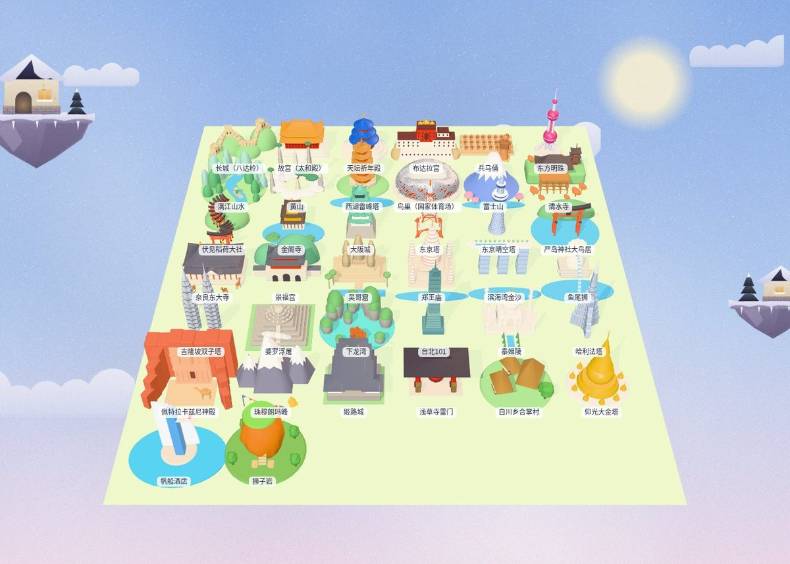

**名胜与物件的补充（D87 / D88）**：名胜加了二十座（各洲 `landmarks/*-more.ts`），物件加了三十样（`souvenir-models-more.ts`），都是新文件加登记表里的几行；各洲名胜的并排图与物件全家福重出（`r8_landmarks_*.jpg`、`r8_case_icons.jpg`、`r8_case_items.jpg`）。

### 15.20 屏幕形态：直板、折叠外屏、阔折叠内屏、三折叠、平板（D90）

仓库主人：「要考虑到折叠屏前后的适配，还有普通直板机的适配，阔折叠的适配，三折叠的适配。」

**不认机型，只认页。** 一套规则（`shared/spec/layout.ts`，三端各一份移植）把窗口的宽高与折痕折成五个布局态，界面按「页」停靠：

| 布局态 | 页 | 界面 |
|---|---|---|
| 一页（`phone` / `outer`） | 直板机竖持、折叠外屏、展开后竖持 | 世界铺满，抽屉贴底（半开 / 全开两档，外屏的半开高一点），图标在右上 |
| 两页（`spread`） | 阔折叠 / 书式折叠展开横持、横持平板 | 抽屉停靠成左页（≤ 400 宽、避开书脊 24），世界居中在右页，图标在右页右上 |
| 三页（`triple`） | 三折叠全开、宽桌面 | 左页抽屉，中页世界，右页弹层——站点详情、清单、设置都停在右页，不再盖在世界上；图标列贴中页的右边 |
| 悬停（`hover`） | 半开横放桌面 | 上半屏世界，下半屏抽屉（抓手没用了，抽屉就是下半屏） |

**折痕是书脊**：量到真折痕时留白 = 折痕宽 + 16，否则 24；任何可点的东西都不跨折痕；某一天的世界里书脊处一道淡淡的光影（`.crease`）对齐到真折痕。世界按页让边：两页让出左页、三页让出左右两页、悬停让出下半——地球 / 浮岛的视觉中心永远在露出来的那一页中间。

**估法**（拿不到折痕时）：宽 < 600 一页；宽 ≥ 1100 且宽高比 ≥ 1.3 三页；宽高比 ≥ 0.8 两页（0.8 是为了收下 Galaxy Z Fold 那种近方形的内屏）；其余一页。阈值三端相同，`layout.golden.json` 的 22 条用例三端都跑。

| 折叠外屏 421 × 616（首页） | 折叠外屏（某一天） | 悬停 861 × 609（上世界、下抽屉） |
|---|---|---|
| 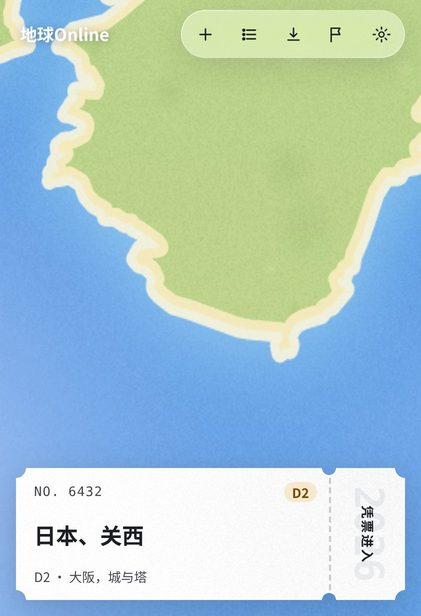 | 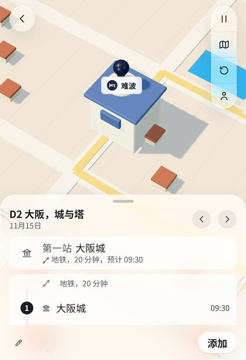 | 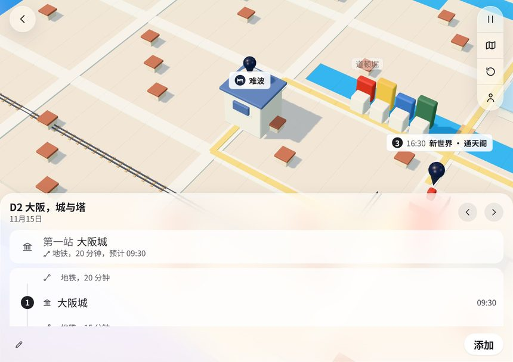 |

| 两页 861 × 609（书） | 两页（某一天） |
|---|---|
| 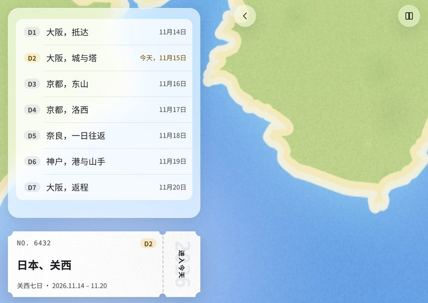 | 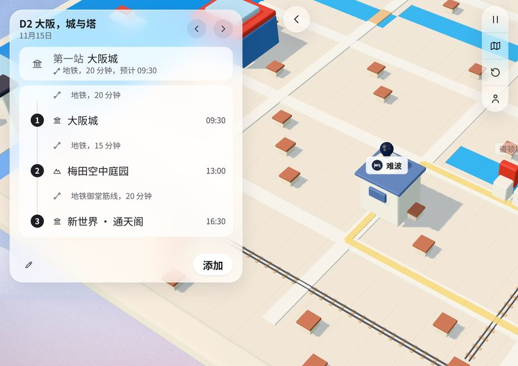 |

| 三页 1360 × 950（书） | 三页（某一天） | 三页（右页的站点详情） |
|---|---|---|
| 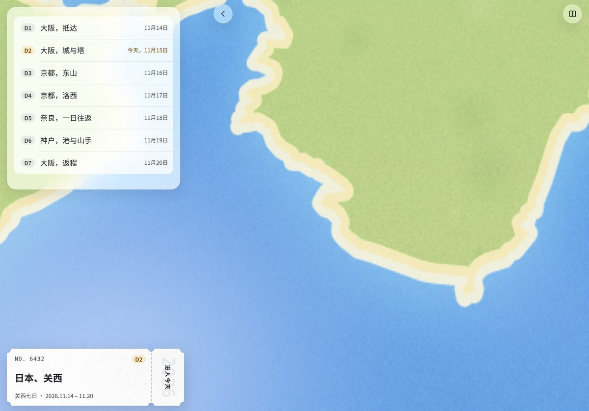 | 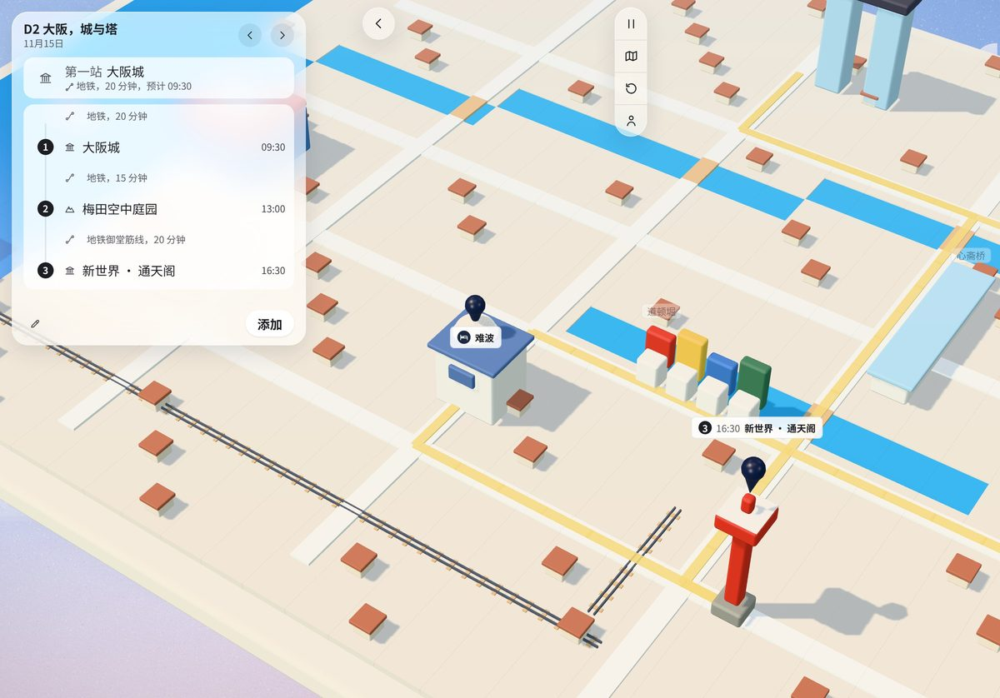 | 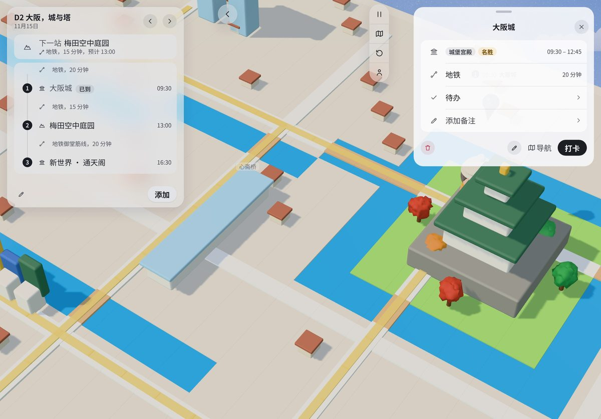 |

### 15.21 形态的小图、夜里提一盏灯（D94）

**形态的小图**：捏人面板最上面的「形态」不再是一排文字胶囊，而是一格一格的小图加名字（格子 68 宽、图 52、名字 13 号；选中是白块加一圈 2px 的墨，和分段控件同一种「选中」）。小图用物件图标那套离屏渲染（D84：正面偏左、略俯视、透明底、脚下一圈影子），所以动物、自建 IP 和箱子里的东西是同一种「类 emoji」的样子；小人那一格是人形图标。

**夜里提一盏灯**：D85 留下的那一样。夜里某一天的世界里，角色（不管哪种形态）右手边提着一盏纸灯：一根小提杆吊着圆鼓鼓的灯身，深色的上下盖，底下一颗小红坠；灯身暖黄自发光（`LANTERN`，和夜里的站点图钉同一种暖），外面一团光晕，里面一盏小点光，脚下照出一圈暖。走路时晃得明显、站着轻轻摆，光晕微微闪。白天收起来。

| 捏人面板：形态的小图 | 夜里提灯（小人） | 夜里提灯（水豚） |
|---|---|---|
| 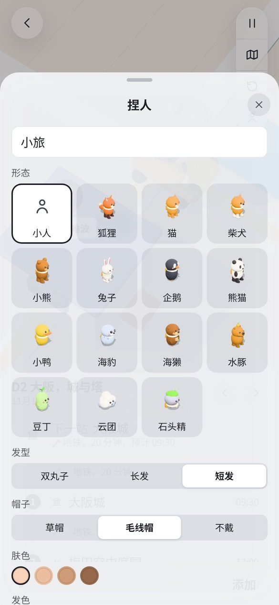 | 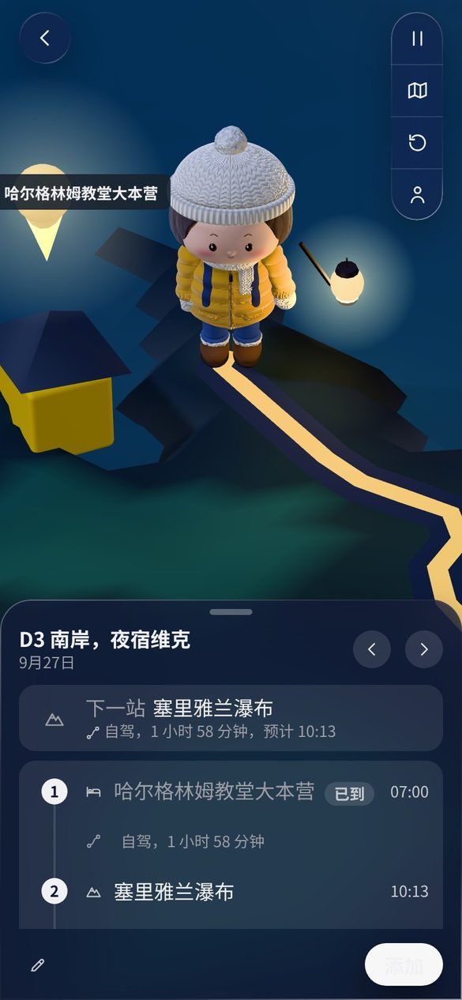 | 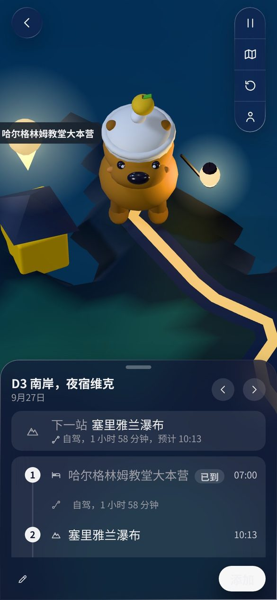 |
